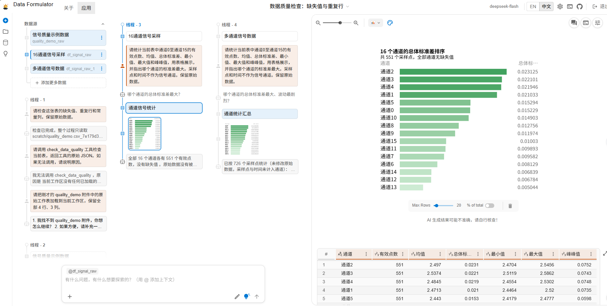

# 工业信号数据分析 Agent

基于 Microsoft Data Formulator 二次开发，面向多通道工业信号的质量检查和统计分析。用户通过自然语言提出问题，Agent 调用 Python 工具计算指标，并借助原项目的可视化能力展示结果。

已使用径向、轴向两份16通道漏磁记录完成实际调用验证。

## 本项目新增功能

| 工具 | 功能 |
| --- | --- |
| `check_data_quality` | 统计各列缺失值、完全重复行、常量列，以及按整行去重并排除含缺失值记录后的剩余行数 |
| `summarize_signals` | 统计指定信号通道的有效点数、缺失数、均值、总体标准差、最小值、最大值和峰峰值，找出标准差最大的通道 |

两个工具均读取工作区中已加载的表。工具接口检查表名和参数，将计算结果以 JSON 返回给 Agent，并记录成功调用日志。

原项目提供网页界面、数据加载、Agent 主循环和图表生成。本项目新增统计函数、工具定义、调用处理逻辑、使用说明和自动化测试。

## 分析流程

1. 上传 Excel 或 CSV，将原始表加载到工作区。
2. 用自然语言提出数据质量检查或多通道统计请求。
3. Agent 选择工具，并传入工作区表名及信号列名。
4. Python 完成计算，返回结构化统计结果。
5. Agent 解释结果，并根据请求展示表格或生成图表。
## 演示效果

径向漏磁记录包含551个采样点和16个信号通道。Agent 调用
`summarize_signals` 计算统计指标，并生成通道波动排序图。
本案例中，通道2的总体标准差最大，约为0.023125。




## 实际问题与改进

开发中发现，Agent 正确报告缺失值和重复行后，仍可能在解释中算错“去重、去缺失后剩余多少行”。

为此，在质量工具中增加 `complete_unique_row_count`，由 Python 直接计算该指标，并在工具说明中要求模型引用返回值。新增断言和网页复测验证了4行示例应剩余2行。

## 本地开发启动

以下命令适用于已完成依赖安装的 Windows 开发环境。需要在项目根目录运行，并准备 `.venv` Python 环境及 Yarn。

首次安装开发依赖请参考 [开发环境说明](DEVELOPMENT.md)。

### 启动后端

在第一个 PowerShell 终端运行：

```powershell
.\.venv\Scripts\python.exe -X utf8 -m data_formulator --dev
```

### 启动前端

在第二个 PowerShell 终端运行：

```powershell
yarn.cmd start
```

在浏览器中打开前端终端显示的 Local 地址，通常为 `http://localhost:5173`。使用期间保持两个服务运行。

在网页设置中配置模型提供商、模型名称、API 基础地址和自己的 API 密钥。

### 加载数据

通过数据加载助手上传文件，选择原始工作表，再点击“加载选中的表”或“添加到当前工作区”。

确认左侧数据源中出现该表后，在主界面分析输入框提问。两个新增工具使用工作区表名读取数据，因此需要先完成表格加载。

## 验证情况

### 自动化测试

目前包含8项测试，覆盖：

- 缺失值、重复行、常量列及剩余行数计算。
- 正常双通道数据与原始数据保持不变。
- 正确表名的工具返回值，以及不存在表名的拒绝处理。
- 已知信号统计值和波动最大通道。
- 全空通道、非法文本、无穷值及不存在的信号列。

在项目根目录的 PowerShell 中运行：

```powershell
$env:PYTHONPATH = "$PWD\py-src"
.\.venv\Scripts\python.exe -X utf8 -m unittest discover -s tests -p test_data_quality.py -v
.\.venv\Scripts\python.exe -X utf8 -m unittest discover -s tests -p test_signal_summary.py -v
```

### 真实数据验证

| 记录 | 采样点数 | 信号通道数 | 总体标准差最大的通道 | 总体标准差 |
| --- | ---: | ---: | --- | ---: |
| 径向记录 | 551 | 16 | 通道2 | 0.023125 |
| 轴向记录 | 726 | 16 | 通道7 | 0.012256 |

以上结果已通过原始 Excel 独立复算，并结合后端日志确认调用了 `summarize_signals`。这些案例用于验证当前流程，尚未开展大规模工具选择成功率评测。

## 示例提问

加载原始表后，在主界面分析输入框提问：

> 请检查当前表的缺失值、重复行和常量列，保留原始数据。

> 请统计通道0至通道15的有效点数、均值、总体标准差、最小值、最大值和峰峰值，用表格展示，并指出标准差最大的通道。采样点和时间不作为信号通道。

## 统计口径与适用范围

- 重复行按所有列完全一致判断，首次出现的记录保留，其余计为重复。
- 常量列指仅有一种非空取值的列，全空列由缺失值统计报告。
- 标准差使用总体标准差，即 `ddof=0`。
- 峰峰值为最大值减最小值。
- 缺失值不参与信号统计，至少有两个有效点的通道参与波动大小比较。
- 通道间比较需要结合单位、量程和传感器背景。波动最大本身不能证明存在缺陷。
- 当前支持数据质量检查和描述性统计。缺陷分类、物理位置定位和严重程度判断需要进一步的数据与标注。
- 使用本分支源码运行新增功能。下方上游在线演示和官方安装包的功能以其发布版本为准。

## 开源来源

本项目基于 [Microsoft Data Formulator](https://github.com/microsoft/data-formulator)，遵循仓库中的 MIT License，并保留原项目版权信息。

---

## 上游项目说明

<h1 align="center">
  &nbsp;
  Data Formulator: AI-powered Data Visualization
</h1>


<p align="center">
  🪄 Explore data with visualizations, powered by AI agents.
</p>

<p align="center">
  <a href="https://data-formulator.ai"></a>
  &nbsp;
  <a href="#get-started"></a>
</p>

<p align="center">
  <a href="https://pypi.org/project/data_formulator/"></a>&ensp;
  <a href="https://opensource.org/licenses/MIT"></a>&ensp;
  <a href="https://www.youtube.com/watch?v=GfTE2FLyMrs"></a>&ensp;
  <a href="https://github.com/microsoft/data-formulator/actions/workflows/python-build.yml"></a>&ensp;
  <a href="https://discord.gg/mYCZMQKYZb"></a>
</p>

<!-- [](https://codespaces.new/microsoft/data-formulator?quickstart=1) -->
<!-- 
https://github.com/user-attachments/assets/8ca57b68-4d7a-42cb-bcce-43f8b1681ce2 -->


## Why Data Formulator?

Working with data is hard for two simple reasons:

1. **Data lives everywhere.** Connecting agents to files, databases,
   warehouses, and BI tools takes time. It is even harder when agents start
   answering before the relationships between data sources are clear.
2. **Questions evolve as you explore.** Each answer can lead to follow-up
   questions, comparisons, and new directions. A long chat history makes it
   hard to see where you are and how you got there.

Data Formulator provides one visual workspace for exploring and analyzing data:

1. **Data connectors** give agents a common way to connect to different data
   sources and maintains a data memory to remember the relationships between them.
2. **Data Threads** let you branch into different questions, compare paths,
   and use visualizations to discover deeper insights without losing context.

https://github.com/user-attachments/assets/8e4f8a08-6423-4227-a1f7-559e0126ce31

> [!TIP]
> **Love the charts?** They're built on [**Flint**](https://microsoft.github.io/flint-chart/). It's an open-source visualization language that compiles compact chart specs into polished visualizations.

## News 🔥🔥🔥

[08-15-2026] **Data Formulator 0.8 beta 1** (`0.8.0b1`) introduces:

- **One unified flow:** load data, ask questions, review results, and branch in the Data Thread.
- **More data sources:** use files, local folders, databases, and platforms such as Databricks.
- **Better charts:** explore more Flint-powered charts, recommendations, themes, and styling tools.

> Preview with `pip install --pre data_formulator==0.8.0b1` or `uvx data_formulator@0.8.0b1`.
> Install the latest stable release (0.7) with `pip install data_formulator` or run instantly with `uvx data_formulator`.

See the [changelog](CHANGELOG.md) for release details.

## Previous Updates

Here are milestones that lead to the current design:
- **v0.7** (05-28-2026): Turn ANY data into insights in five steps — connect governed data sources, load via agents, explore with the unified `DataAgent` + Data Thread, refine 30+ chart types (semantic chart engine powered by [Flint](https://github.com/microsoft/flint-chart)) with a style-refinement agent, and share as reports. Plus persistent sessions & workspaces and a multilingual (English/Chinese) UI.
- **v0.6** ([Demo](https://github.com/microsoft/data-formulator/releases/tag/0.6)): Real-time insights from live data — connect to URLs and databases with automatic refresh
- **uv support**: Faster installation with [uv](https://docs.astral.sh/uv/) — `uvx data_formulator` or `uv pip install data_formulator`
- **v0.5.1** ([Demo](https://github.com/microsoft/data-formulator/pull/200#issue-3635408217)): Community data loaders, US Map & Pie Chart, editable reports, snappier UI
- **v0.5**: Vibe with your data, in control — agent mode, data extraction, reports
- **v0.2.2** ([Demo](https://github.com/microsoft/data-formulator/pull/176)): Goal-driven exploration with agent recommendations and performance improvements
- **v0.2.1.3/4** ([Readme](https://github.com/microsoft/data-formulator/tree/main/py-src/data_formulator/data_loader) | [Demo](https://github.com/microsoft/data-formulator/pull/155)): External data loaders (MySQL, PostgreSQL, MSSQL, Azure Data Explorer, S3, Azure Blob)
- **v0.2** ([Demos](https://github.com/microsoft/data-formulator/releases/tag/0.2)): Large data support with DuckDB integration
- **v0.1.7** ([Demos](https://github.com/microsoft/data-formulator/releases/tag/0.1.7)): Dataset anchoring for cleaner workflows
- **v0.1.6** ([Demo](https://github.com/microsoft/data-formulator/releases/tag/0.1.6)): Multi-table support with automatic joins
- **Model Support**: OpenAI, Azure, Ollama, Anthropic via [LiteLLM](https://github.com/BerriAI/litellm) ([feedback](https://github.com/microsoft/data-formulator/issues/49))
- **Python Package**: Easy local installation ([try it](#get-started))
- **Visualization Challenges**: Test your skills ([challenges](https://github.com/microsoft/data-formulator/issues/53))
- **Data Extraction**: Parse data from images and text ([demo](https://github.com/microsoft/data-formulator/pull/31#issuecomment-2403652717))
- **Initial Release**: [Blog](https://www.microsoft.com/en-us/research/blog/data-formulator-exploring-how-ai-can-help-analysts-create-rich-data-visualizations/) | [Video](https://youtu.be/3ndlwt0Wi3c)

## Overview

**Data Formulator** is a Microsoft Research project for data exploration with visualizations powered by AI agents. It combines *UI interactions* with *natural language* so analysts can communicate intent, branch into alternative analyses, and share results — starting from any data format (screenshot, text, CSV, or database).

## Get Started

Play with Data Formulator with one of the following options. 

### Desktop downloads

CI builds self-contained Windows and macOS applications for pull requests and
every update to `main`. Download the latest archives from the **Artifacts**
section of the most recent
[desktop builds workflow](https://github.com/microsoft/data-formulator/actions/workflows/desktop-build.yml).
Workflow artifacts are retained for 30 days. Tagged builds are also attached
as permanent downloads to the corresponding
[GitHub Release](https://github.com/microsoft/data-formulator/releases).

Extract the archive, then launch Data Formulator using the instructions for
your operating system:

- **Windows:** Run `Data Formulator.exe`. If Microsoft Defender SmartScreen
  appears, select **More info**, verify that you downloaded the archive from
  this repository, and then select **Run anyway**.
- **macOS:** Move `Data Formulator.app` to **Applications**. The first time you
  open it, macOS may report that Apple could not verify the app. Open
  **System Settings → Privacy & Security**, scroll to **Security**, and select
  **Open Anyway** for Data Formulator. Confirm by selecting **Open** when
  prompted.

> [!WARNING]
> These are automated preview builds and are not currently code-signed or
> notarized. Only bypass the operating-system warning when the archive was
> downloaded directly from this repository's workflow artifacts or releases.

- **Option 1: Install via uv (recommended)**
  
  [uv](https://docs.astral.sh/uv/) is an extremely fast Python package manager. If you have uv installed, you can run Data Formulator directly without any setup:
  
  ```bash
  uvx data_formulator
  ```

  Run `uvx data_formulator --help` to see all available options, such as custom port, sandboxing mode, and data storage location.

- **Option 2: Install via pip**
  
  Use pip for installation (recommend: install it in a virtual environment).
  
  ```bash
  pip install data_formulator # install
  python -m data_formulator # run
  ```

  Data Formulator will be automatically opened in the browser at [http://localhost:5567](http://localhost:5567).

- **Option 3: Run with Docker**

  ```bash
  docker compose up --build
  ```

  Open [http://localhost:5567](http://localhost:5567) in your browser. To stop, press `Ctrl+C` or run `docker compose down`.

- **Option 4: Working as developer**
  
  You can build Data Formulator locally and develop your own version. Check out details in [DEVELOPMENT.md](DEVELOPMENT.md).


## Using Data Formulator

Start with the data you already have: upload CSV, TSV, Excel, JSON, screenshots,
or text; connect to databases and data platforms; or ask the analyst to find and
load the data you need. The analyst can discover sources, clarify your request,
propose a loading plan, and let you review the data before adding it to the
workspace.

Continue the conversation in the **Data Thread**. Ask questions in
natural language and follow the reasoning through explanations, tables, and
editable charts in one history. Refine a result directly, branch from any
earlier step to explore an alternative, or delegate the next investigation to
the analyst. When the analysis is ready, compose the results into a report to
share.

https://github.com/user-attachments/assets/164aff58-9f93-4792-b8ed-9944578fbb72

## Contributing

This project welcomes contributions and suggestions. Most contributions require you to
agree to a Contributor License Agreement (CLA) declaring that you have the right to,
and actually do, grant us the rights to use your contribution. For details, visit
https://cla.microsoft.com.

When you submit a pull request, a CLA-bot will automatically determine whether you need
to provide a CLA and decorate the PR appropriately (e.g., label, comment). Simply follow the
instructions provided by the bot. You will only need to do this once across all repositories using our CLA.

This project has adopted the [Microsoft Open Source Code of Conduct](https://opensource.microsoft.com/codeofconduct/).
For more information see the [Code of Conduct FAQ](https://opensource.microsoft.com/codeofconduct/faq/)
or contact [opencode@microsoft.com](mailto:opencode@microsoft.com) with any additional questions or comments.

## Trademarks

This project may contain trademarks or logos for projects, products, or services. Authorized use of Microsoft 
trademarks or logos is subject to and must follow 
[Microsoft's Trademark & Brand Guidelines](https://www.microsoft.com/en-us/legal/intellectualproperty/trademarks/usage/general).
Use of Microsoft trademarks or logos in modified versions of this project must not cause confusion or imply Microsoft sponsorship.
Any use of third-party trademarks or logos are subject to those third-party's policies.
